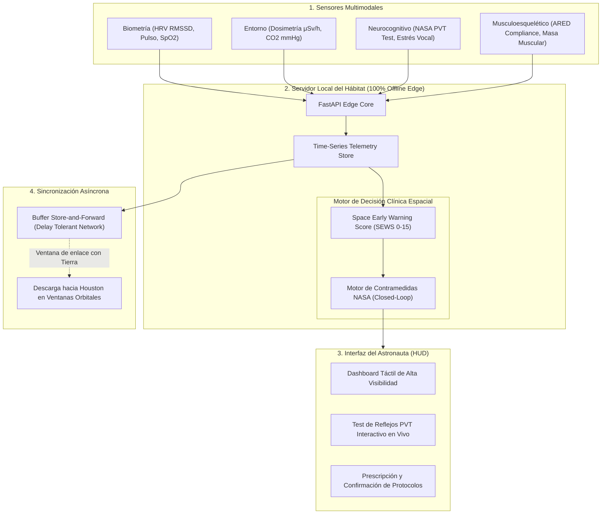

# 🚀 A-HAMS: Autonomous Health Assessment & Monitoring System
### *Sistema Autónomo de Monitorización de la Salud y Soporte Clínico para Misiones Espaciales de Larga Duración*

[](https://www.spaceappschallenge.org/)
[](https://www.python.org/)
[](https://fastapi.tiangolo.com/)
[](https://tailwindcss.com/)
[](https://en.wikipedia.org/wiki/Edge_computing)
[](LICENSE)

---

## 🛰️ 1. Contexto Operacional: El Desafío de los 40 Minutos

En misiones de espacio profundo (como el tránsito a **Marte** o bases lunares **Artemis**), los astronautas enfrentan los 5 riesgos críticos definidos por el **NASA Human Research Program (HRP)**:
1. **R**adiación espacial cósmica (GCR y eventos de partículas solares SPE).
2. **I**solación y confinamiento (fatiga cognitiva, burnout, trastornos circadianos).
3. **D**istancia a la Tierra (latencia de radio crítica de 4 a 24 minutos unidireccional).
4. **G**ravedad alterada (microgravedad: atrofia muscular, osteopenia, desacondicionamiento cardiovascular).
5. **E**ntornos hostiles y cerrados (acumulación de CO2, presión de cabina).

> [!IMPORTANT]
> **La Imposibilidad de la Telemedicina en Tiempo Real:**
> En Marte, una señal de radio tarda entre **4 y 24 minutos en llegar a la Tierra** y otro tanto en volver (**hasta 48 minutos de latencia total**). En una descompensación clínica o evento agudo, **llamar a Houston no es viable**.
> La tripulación debe contar con un **sistema de decisión médica autónomo que viva 100% dentro de la nave**, sin depender de internet ni de la nube terrestre.

---

## 💡 2. Nuestra Solución: A-HAMS

**A-HAMS** es una plataforma de **Soporte de Decisión Clínica Autónomo (CDSS - Clinical Decision Support System)** basada en **Edge Computing** que recopila indicadores multimodales, evalúa el estado del astronauta mediante el índice **SEWS** y prescribe **contramedidas inmediatas**.



---

## ✨ 3. Características Principales

* 🔒 **100% Offline-First / Edge Computing:** Cero llamadas a APIs externas o nubes terrestres. Ejecución autónoma en el hardware del hábitat.
* 🩺 **Space Early Warning Score (SEWS):** Algoritmo clínico especializado que pondera variables cruzadas:
  * *Puntuación 0 a 4:* **NOMINAL** (Estado óptimo).
  * *Puntuación 5 a 8:* **ALERTA MODERADA** (Intervención preventiva requerida).
  * *Puntuación ≥ 9:* **ALERTA CRÍTICA** (Intervención de emergencia o restricción de operaciones).
* ⚡ **Motor Prescriptivo de Contramedidas:** No es solo un dashboard informativo; prescribe la acción clínica exacta:
  * **Fototerapia dinámica** (ajuste espectral LED a 460nm o 2200K ámbar) para sincronización circadiana.
  * **Sobrecarga excéntrica ARED** y suplementación nutricional para atrofia muscular acelerada.
  * **Evacuación a la Bahía de Tormenta blindada** en eventos de radiación solar (SPE).
* 🧠 **Salud Mental y Monitoreo Psicológico Multimodal:**
  * **Biomarcador acústico de voz:** Detección de fatiga y depresión por aplanamiento prosódico y pausas del habla.
  * **Micro-checkin emocional de 1 toque:** Basado en el Modelo Circumplejo de Russell (Valencia y Activación).
  * **Biofeedback de Coherencia Cardíaca 0.1 Hz:** Respiración guiada en el smartwatch (4s inhalar, 6s exhalar) con pulsos hápticos y tonos armónicos reparadores.
  * **Contramedida para Privación Sensorial (Earth VR):** Simulación sensorial inmersiva de entornos terrestres con audio biofílico offline.
* ⚡ **Test Neurocognitivo PVT (Psychomotor Vigilance Task) en Vivo:** Implementación interactiva del test psicomotor oficial de la NASA para medir reflejos y fatiga en milisegundos directamente en el navegador.
* 📡 **Buffer DTN (Delay-Tolerant Networking):** Encola los reportes en un almacenamiento local resiliente para su transmisión asíncrona hacia el Centro de Control de Vuelo cuando haya ventana de línea de vista.
* 🔌 **Patrón Adaptador para Datos de la NASA:** Preparado con un adaptador desacoplado para consumir cualquier formato de datos oficial (CSV, JSON, etc.) entregado el día del hackatón.

---

## 📂 4. Estructura del Repositorio

```text
desafio_nasa/
│
├── .gitignore                         # Exclusiones estándar (Python, venv, cache, IDEs)
├── README.md                          # Documentación completa del proyecto
│
├── data/
│   └── crew_telemetry_sample.json     # Dataset sintético de 4 perfiles y 14 días de misión
│
├── backend/
│   ├── requirements.txt               # Dependencias (FastAPI, uvicorn, pydantic, numpy)
│   ├── app/
│   │   ├── __init__.py                # Módulo Python del core
│   │   ├── main.py                    # API Edge FastAPI con endpoints clínicos y DTN
│   │   ├── models.py                  # Modelos de datos Pydantic fuertemente tipados
│   │   ├── clinical_engine.py         # Motor de cálculo SEWS y prescripción médica
│   │   └── data_adapter.py            # ⭐ Adaptador universal para los datasets de la NASA
│   └── scripts/
│       └── generate_synthetic_data.py # Generador de datos sintéticos con anomalías clínicas
│
└── frontend/
    ├── index.html                     # Dashboard HUD de la Estación (Gráficas, Telemetría, Prescripción)
    └── smartwatch.html                # ⌚ Interfaz Smartwatch de muñeca (Dial circular, Swipes, Mini PVT)
```

---

## 🚀 5. Inicio Rápido (Quick Start)

### Opción 1: Visualización Inmediata (Sin instalar dependencias)
El frontend incluye modo autónomo con datos de telemetría precargados:
1. Clona o descarga el repositorio:
   ```bash
   git clone https://github.com/FanyNic23/MELLINA-SPACE.git
   cd MELLINA-SPACE
   ```
2. **Abrir cualquiera de las dos interfaces:**
   * **Dashboard Hábitat (`frontend/index.html`):** Vista de estación médica para monitoreo de la tripulación completa.
   * **Smartwatch Astronauta (`frontend/smartwatch.html`):** Vista táctil de muñeca para el astronauta en movimiento (soporta gestos de deslizamiento táctil, alertas acústicas Web Audio y conmutador circular/cuadrado).

---

### Opción 2: Ejecución Full-Stack con Backend Edge (FastAPI)

1. **Crear y activar un entorno virtual (recomendado):**
   ```bash
   # En Windows PowerShell:
   python -m venv venv
   .\venv\Scripts\Activate.ps1
   ```

2. **Instalar dependencias:**
   ```bash
   pip install -r backend/requirements.txt
   ```

3. **(Opcional) Generar telemetría sintética:**
   ```bash
   python backend/scripts/generate_synthetic_data.py
   ```

4. **Iniciar el servidor local Edge de la nave:**
   ```bash
   python -m uvicorn app.main:app --reload --app-dir backend
   ```
   * El servidor iniciará en: `http://127.0.0.1:8000`
   * Documentación interactiva de la API (Swagger UI): `http://127.0.0.1:8000/docs`

5. **Abrir el Frontend:**
   * Abre `frontend/index.html` en tu navegador.

---

## 👩‍🚀 6. Perfiles Clínicos Simulados en la Misión

El sistema incluye 4 tripulantes con escenarios clínicos basados en la literatura médica de la NASA:

| Tripulante | Rol | Condición | SEWS | Contramedida Principal |
| :--- | :--- | :--- | :---: | :--- |
| **Dra. Elena Rostova** | Comandante | **Nominal (Control)** | `02/15` | Mantenimiento estándar: 2.5h ARED/T2. |
| **Marcus Vance** | Ingeniero de Vuelo | **Atrofia Muscular Acelerada** (-6.8%) por baja adherencia a ARED | `10/15` | Protocolo intensivo excéntrico ARED (85% 1RM) + suplemento de 35g proteína. |
| **Dr. Kenji Sato** | Oficial Científico | **Fatiga Psicomotriz y Burnout** (HRV: 18ms, 3 lapsos PVT, sueño < 4.5h) | `09/15` | Higiene circadiana (luz ámbar 2200K) + ventana forzada de reposo de 9h. |
| **Dra. Sarah Miller** | Especialista Médica | **Evento de Partículas Solares (SPE)** (Radiación ambiental 89 μSv/h) | `07/15` | Evacuación inmediata a bahía blindada central hasta normalización (<25 μSv/h). |

---

## 🔌 7. ¿Cómo conectar los datos oficiales de la NASA el día del Hackatón?

Gracias al **Patrón de Diseño Adapter** implementado en [`backend/app/data_adapter.py`](backend/app/data_adapter.py), conectar los datasets que entregue la NASA el día del hackatón toma **menos de 2 minutos**:

1. Abre `backend/app/data_adapter.py`.
2. Modifica únicamente los nombres de los campos en el método `from_hackathon_raw_dict`:
   ```python
   # Mapeo según las columnas del archivo entregado por la NASA:
   heart_rate_bpm   = float(raw.get("NASA_HR_COLUMN", 72.0))
   hrv_rmssd_ms     = float(raw.get("NASA_RMSSD_COLUMN", 42.0))
   radiation_rate   = float(raw.get("NASA_DOSIMETER_COLUMN", 22.5))
   reaction_time_ms = float(raw.get("NASA_PVT_RT_COLUMN", 240.0))
   ```
3. El motor clínico, las alertas, las gráficas y las contramedidas procesarán los datos reales automáticamente.

---

## 🏆 8. Enfoque de Ingeniería de Sistemas frente al Jurado

| Enfoque Común de otros proyectos | Enfoque de Ingeniería de Sistemas de A-HAMS |
| :--- | :--- |
| Dependencia de internet / APIs cloud en la Tierra | **100% Edge Computing:** Diseñado para funcionar desconectado en el espacio profundo. |
| Dashboards solo descriptivos (gráficas sin acción) | **Motor Prescriptivo:** Cada riesgo dispara un protocolo médico espacial validado. |
| Solo miden pulso o pasos de un reloj comercial | **Multimodalidad:** Cruce de fisiología, radiación ambiental, test cognitivo PVT y masa muscular. |
| Asumen comunicación inmediata con Houston | **Buffer DTN (Delay Tolerant Network)** que modela la latencia real Tierra-Marte. |

---

## 📄 Licencia

Este proyecto está bajo la Licencia **MIT**. Consulta el archivo `LICENSE` para más detalles.
