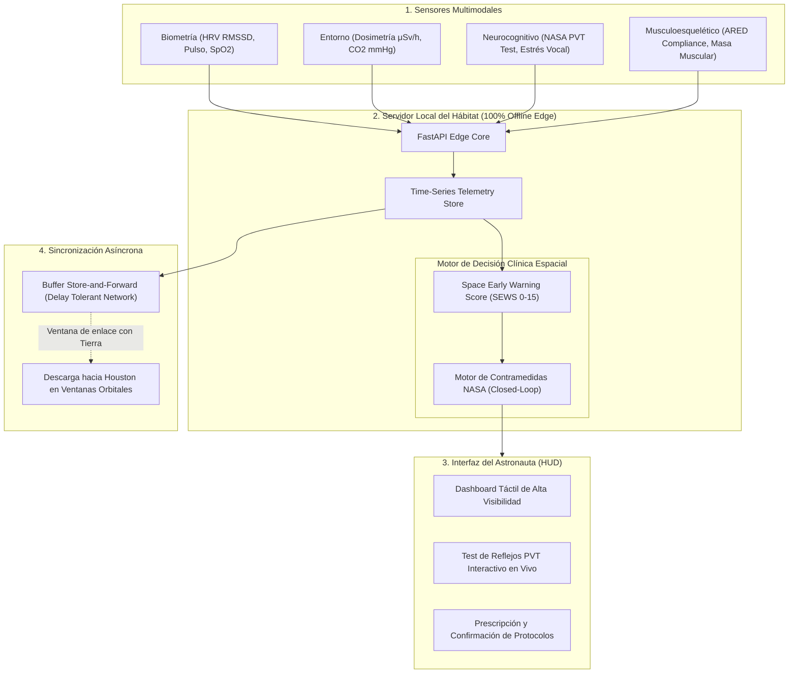

# 🚀 A-HAMS: Autonomous Health Assessment & Monitoring System
### *Sistema Autónomo de Monitorización de la Salud y Soporte Clínico para Misiones Espaciales de Larga Duración*

[](https://www.spaceappschallenge.org/)
[](https://www.python.org/)
[](https://fastapi.tiangolo.com/)
[](https://react.dev/)
[](https://www.typescriptlang.org/)
[](https://en.wikipedia.org/wiki/Edge_computing)
[](LICENSE)

---

## 🎯 La propuesta en una línea

> **A-HAMS convierte a cada astronauta en su propio médico de a bordo: le enseña a medirse, le explica qué significa y le dice qué hacer, y cuándo avisar al cirujano de vuelo. Sin depender de la Tierra.**

**Nombre del proyecto:** **A-HAMS** — *Autonomous Health Assessment & Monitoring System*. Su asistente de voz a bordo se llama **Mellina**.

### Nuestro diferenciador: *Mídete · Entiéndete · Actúa*, 100% dentro de la nave

| Pilar | Qué hace | Cómo se ve en la app |
|---|---|---|
| **Mídete** | Chequeo diario guiado: cómo medir cada indicador en el espacio y por qué importa | Presión, pulso (**con la cámara, sin hardware extra**), SpO₂, glucosa, temperatura, sueño y ánimo |
| **Entiéndete** | Un índice propio del espacio (SEWS) que **explica cada punto** | Semáforo por indicador, desglose "+3 por glucosa 58 mg/dL", cuerpo 3D con el órgano afectado |
| **Actúa** | Contramedidas concretas y una regla clara de **cuándo avisar al cirujano de vuelo** | Protocolo paso a paso; las banderas rojas salen con prioridad crítica en la próxima ventana de enlace |
| **Constancia** | Rutina diaria con puntos, niveles, racha e insignias; meta **cooperativa** de toda la tripulación (no competitiva, para no generar tensión en aislamiento) | Pestaña *Rutina*: chequeo, test PVT, respiración, ejercicio, hidratación y cada contramedida activa; el botón de chequeo late si hoy no te mediste |
| **Adaptable** | El mismo sistema sirve en una **nave a Marte, estación orbital, base lunar, base marciana o rover** | Selector de entorno: cambia latencia con la Tierra, gravedad, umbrales de radiación y CO₂, evacuación y si el cirujano atiende en tiempo real |
| **Anticipa** | **Gemelo digital**: proyecta la salud 30 días con el mismo motor SEWS, sin y con contramedidas | Barra de tiempo sobre el cuerpo 3D: *"sin intervención, crítico en 14 días; con contramedidas, SEWS 2"* |

Lo que nadie más junta: **autoevaluación guiada + IA clínica explicable + funcionamiento sin internet** frente a la latencia de 4 a 24 minutos con Marte.

### Demo en 3 minutos
1. *"Día 214 rumbo a Marte. Houston está a 40 minutos. Kenji tiene que cuidarse solo."* — se desconecta el Wi-Fi.
2. **Mídete:** chequeo diario; el pulso se toma con la cámara.
3. **Entiéndete:** SEWS crítico explicado punto por punto y el órgano en rojo en el cuerpo 3D.
4. **Actúa:** contramedida inmediata y aviso al cirujano de vuelo en cola para la próxima ventana de enlace.
5. **Anticipa:** se pulsa *reproducir* en el gemelo digital y se ve el cuerpo de Kenji empeorar 30 días… y recuperarse con las contramedidas.
6. *"Cada astronauta, su propio médico de a bordo."*

---

## 🛰️ 1. Contexto Operacional: El Desafío de los 40 Minutos

En misiones de espacio profundo (como el tránsito a **Marte** o bases lunares **Artemis**), los astronautas enfrentan los 5 riesgos críticos definidos por el **NASA Human Research Program (HRP)**:
1. **R**adiación espacial cósmica (GCR y eventos de partículas solares SPE).
2. **I**solación y confinamiento (fatiga cognitiva, burnout, trastornos circadianos).
3. **D**istancia a la Tierra (latencia de radio crítica de 4 a 24 minutos unidireccional).
4. **G**ravedad alterada (microgravedad: atrofia muscular, osteopenia, desacondicionamiento cardiovascular).
5. **E**ntornos hostiles y cerrados (acumulación de CO2, presión de cabina).

> [!IMPORTANT]
> **La Imposibilidad de la Telemedicina en Tiempo Real:**
> En Marte, una señal de radio tarda entre **4 y 24 minutos en llegar a la Tierra** y otro tanto en volver (**hasta 48 minutos de latencia total**). En una descompensación clínica o evento agudo, **llamar a Houston no es viable**.
> La tripulación debe contar con un **sistema de decisión médica autónomo que viva 100% dentro de la nave**, sin depender de internet ni de la nube terrestre.

---

## 💡 2. Nuestra Solución: A-HAMS

**A-HAMS** es una plataforma de **Soporte de Decisión Clínica Autónomo (CDSS - Clinical Decision Support System)** basada en **Edge Computing** que recopila indicadores multimodales, evalúa el estado del astronauta mediante el índice **SEWS** y prescribe **contramedidas inmediatas**.



---

## ✨ 3. Características Principales

* 🔒 **100% Offline-First / Edge Computing:** Cero llamadas a APIs externas o nubes terrestres. Ejecución autónoma en el hardware del hábitat.
* 🩺 **Space Early Warning Score (SEWS):** Algoritmo clínico especializado que pondera variables cruzadas:
  * *Puntuación 0 a 4:* **NOMINAL** (Estado óptimo).
  * *Puntuación 5 a 8:* **ALERTA MODERADA** (Intervención preventiva requerida).
  * *Puntuación ≥ 9:* **ALERTA CRÍTICA** (Intervención de emergencia o restricción de operaciones).
* ⚡ **Motor Prescriptivo de Contramedidas:** No es solo un dashboard informativo; prescribe la acción clínica exacta:
  * **Fototerapia dinámica** (ajuste espectral LED a 460nm o 2200K ámbar) para sincronización circadiana.
  * **Sobrecarga excéntrica ARED** y suplementación nutricional para atrofia muscular acelerada.
  * **Evacuación a la Bahía de Tormenta blindada** en eventos de radiación solar (SPE).
* 🧠 **Salud Mental y Monitoreo Psicológico Multimodal:**
  * **Biomarcador acústico de voz:** Detección de fatiga y depresión por aplanamiento prosódico y pausas del habla.
  * **Micro-checkin emocional de 1 toque:** Basado en el Modelo Circumplejo de Russell (Valencia y Activación).
  * **Biofeedback de Coherencia Cardíaca 0.1 Hz:** Respiración guiada en el smartwatch (4s inhalar, 6s exhalar) con pulsos hápticos y tonos armónicos reparadores.
  * **Contramedida para Privación Sensorial (Earth VR):** Simulación sensorial inmersiva de entornos terrestres con audio biofílico offline.
* ⚡ **Test Neurocognitivo PVT (Psychomotor Vigilance Task) en Vivo:** Implementación interactiva del test psicomotor oficial de la NASA para medir reflejos y fatiga en milisegundos directamente en el navegador.
* 📡 **Buffer DTN (Delay-Tolerant Networking):** Encola los reportes en un almacenamiento local resiliente para su transmisión asíncrona hacia el Centro de Control de Vuelo cuando haya ventana de línea de vista.
* 🔌 **Patrón Adaptador para Datos de la NASA:** Preparado con un adaptador desacoplado para consumir cualquier formato de datos oficial (CSV, JSON, etc.) entregado el día del hackatón.

---

## 📂 4. Estructura del Repositorio

```text
MELLINA-SPACE/
├── Makefile                           # setup · run · dev · test · lint
├── Dockerfile                         # Imagen autocontenida (interfaz + Edge Core + Whisper)
├── data/
│   └── crew_telemetry_sample.json     # Dataset sintético de 5 tripulantes por días de misión
│
├── backend/                           # Edge Core · FastAPI + SQLite, sin servicios en la nube
│   ├── .env.example                   # Configuración documentada (copiar a backend/.env)
│   ├── requirements.txt
│   ├── run.py                         # Arranque: API + interfaz compilada en un solo puerto
│   ├── app/
│   │   ├── main.py                    # Ciclo de vida, routers y servido de frontend/dist
│   │   ├── core/                      # Configuración, base de datos, tripulación y entornos de misión
│   │   ├── routers/                   # clinical · simulation · checkin · routine · mission · voice
│   │   └── services/
│   │       ├── clinical_engine.py     # SEWS explicable (desglose por factor) y contramedidas
│   │       ├── forecast.py            # Gemelo digital: proyección a 30 días con y sin contramedidas
│   │       ├── sews_dataset.py        # Datos de misión, chequeos diarios y panel de simulación
│   │       ├── routine.py             # Rutina diaria, puntos, racha e insignias
│   │       ├── sync_queue.py          # Store-and-forward Tierra-Espacio (AOS / LOS)
│   │       ├── stt.py                 # Reconocimiento de voz con Whisper local
│   │       ├── ai_copilot.py          # Copiloto de alertas con reglas deterministas
│   │       └── data_adapter.py        # Adaptador para los datasets de la NASA
│   ├── scripts/                       # Datos sintéticos y descarga única del modelo de voz
│   └── tests/smoke_test.py            # Prueba de extremo a extremo (100% local)
│
└── frontend/                          # Interfaz · React 19 + TypeScript + Vite + Tailwind v4
    ├── public/                        # Anatomía 3D (BodyParts3D), fotos de la tripulación, marca
    ├── tools/build-anatomy.mjs        # Genera public/anatomy a partir de BodyParts3D
    └── src/
        ├── api/                       # Cliente tipado del Edge Core
        ├── state/                     # Misión, cuerpo 3D y avisos (React context)
        ├── components/                # Dashboard, pestañas, chequeo diario y reloj (watch/)
        └── lib/                       # Cuerpo 3D, pulso por cámara (rPPG), asistente Mellina
```

La interfaz es una sola aplicación con dos vistas: el **dashboard del hábitat** (`/#/`) y el **reloj del tripulante** (`/#/reloj?crew=ASTRO-03`).

---

## 🚀 5. Inicio Rápido

Requisitos: **Python 3.12** y **Node 22** (solo para compilar la interfaz). Internet se necesita una única vez, para instalar dependencias y el modelo de voz; después todo funciona desconectado.

### Opción 1: Make

```bash
git clone https://github.com/FanyNic23/MELLINA-SPACE.git
cd MELLINA-SPACE
make setup   # venv + dependencias + compila la interfaz + modelo Whisper
make run     # http://127.0.0.1:8000
```

| Comando | Qué hace |
|---|---|
| `make run` | Edge Core en `http://127.0.0.1:8000` sirviendo API e interfaz |
| `make dev` | Backend con recarga + Vite en `http://localhost:5173` (proxy a la API) |
| `make test` | Prueba de extremo a extremo del backend |
| `make lint` | oxlint + comprobación de tipos de la interfaz |
| `make whisper WHISPER=base` | Instala otro tamaño del modelo de voz |

### Opción 2: Docker

```bash
docker build -t ahams .
docker run --rm -p 8000:8000 -v ahams-runtime:/app/backend/runtime ahams
```

La imagen incluye la interfaz compilada y el modelo Whisper; en ejecución no descarga nada. El volumen conserva chequeos, rutina y entorno entre reinicios.

### Opción 3: Paso a paso

```bash
python -m venv venv
source venv/bin/activate              # Windows: .\venv\Scripts\Activate.ps1
pip install -r backend/requirements.txt
cp backend/.env.example backend/.env
python backend/scripts/download_whisper_model.py
cd frontend && npm ci && npm run build && cd ..
python backend/run.py
```

* Dashboard: `http://127.0.0.1:8000` · Reloj: `http://127.0.0.1:8000/#/reloj` · API: `http://127.0.0.1:8000/docs`
* **Idioma:** la interfaz arranca en **inglés**; el selector **EN / ES** de la cabecera la cambia a español y se recuerda en el navegador. El motor clínico (diagnósticos, contramedidas, gemelo digital, rutina y entornos) responde en el idioma pedido con la cabecera `X-Lang`, y Mellina habla y escucha en ese idioma.
* Toda la configuración (host, puerto, rutas de datos y Whisper) vive en `backend/.env`. `WHISPER_MODEL=base` es más rápido; `small` (por defecto) entiende mejor.
* **100% offline:** el sistema no usa ninguna API ni servicio en la nube. Todo corre en el hábitat:

  | Función | Cómo funciona |
  |---|---|
  | Evaluación clínica | Motor SEWS y reglas deterministas en el Edge Core |
  | Asistente Mellina | Respuestas generadas con los datos del motor clínico |
  | Escuchar | Whisper local (faster-whisper) |
  | Hablar | Voces instaladas en el sistema operativo |
  | Pulso por cámara | rPPG calculado en el navegador; el video nunca sale del dispositivo |
  | Interfaz | React compilada y servida por el mismo Edge Core, con fuentes, iconos y modelo 3D locales |
  | Enlace con Tierra | Cola store-and-forward local con estación en Tierra simulada |

* **Panel de simulación** (pestaña *Simular* o `POST /api/sim/{id}`): crisis predefinidas (tormenta solar, CO₂, fatiga, aislamiento, atrofia) y ajuste manual de cada indicador; el motor clínico reevalúa al instante.

---

## 👩‍🚀 6. Perfiles Clínicos Simulados en la Misión

El sistema incluye 5 tripulantes con escenarios clínicos basados en la literatura médica de la NASA:

| Tripulante | Rol | Condición | SEWS | Contramedida Principal |
| :--- | :--- | :--- | :---: | :--- |
| **Dra. Elena Rostova** | Comandante | **Nominal (Control)** | `02/15` | Mantenimiento estándar: 2.5h ARED/T2. |
| **Marcus Vance** | Ingeniero de Vuelo | **Atrofia Muscular Acelerada** (-6.8%) por baja adherencia a ARED | `10/15` | Protocolo intensivo excéntrico ARED (85% 1RM) + suplemento de 35g proteína. |
| **Dr. Kenji Sato** | Oficial Científico | **Fatiga Psicomotriz y Burnout** (HRV: 18ms, 3 lapsos PVT, sueño < 4.5h) | `09/15` | Higiene circadiana (luz ámbar 2200K) + ventana forzada de reposo de 9h. |
| **Dr. Samuel Miller** | Especialista Médico | **Evento de Partículas Solares (SPE)** (Radiación ambiental 89 μSv/h) | `07/15` | Evacuación inmediata a bahía blindada central hasta normalización (<25 μSv/h). |
| **Dr. Diego Herrera** | Ingeniero de Soporte Vital | **Hipercapnia** (CO₂ 5.9 mmHg en su módulo, sueño < 5h, PVT 312 ms) | `06/15` | Ventilación dirigida del módulo de soporte vital + higiene circadiana. |

---

## 🔌 7. ¿Cómo conectar los datos oficiales de la NASA el día del Hackatón?

Gracias al **Patrón de Diseño Adapter** implementado en [`backend/app/services/data_adapter.py`](backend/app/services/data_adapter.py), conectar los datasets que entregue la NASA el día del hackatón toma **menos de 2 minutos**:

1. Abre `backend/app/services/data_adapter.py`.
2. Modifica únicamente los nombres de los campos en el método `from_hackathon_raw_dict`:
   ```python
   # Mapeo según las columnas del archivo entregado por la NASA:
   heart_rate_bpm   = float(raw.get("NASA_HR_COLUMN", 72.0))
   hrv_rmssd_ms     = float(raw.get("NASA_RMSSD_COLUMN", 42.0))
   radiation_rate   = float(raw.get("NASA_DOSIMETER_COLUMN", 22.5))
   reaction_time_ms = float(raw.get("NASA_PVT_RT_COLUMN", 240.0))
   ```
3. El motor clínico, las alertas, las gráficas y las contramedidas procesarán los datos reales automáticamente.

---

## 🏆 8. Enfoque de Ingeniería de Sistemas frente al Jurado

| Enfoque Común de otros proyectos | Enfoque de Ingeniería de Sistemas de A-HAMS |
| :--- | :--- |
| Dependencia de internet / APIs cloud en la Tierra | **100% Edge Computing:** Diseñado para funcionar desconectado en el espacio profundo. |
| Dashboards solo descriptivos (gráficas sin acción) | **Motor Prescriptivo:** Cada riesgo dispara un protocolo médico espacial validado. |
| Solo miden pulso o pasos de un reloj comercial | **Multimodalidad:** Cruce de fisiología, radiación ambiental, test cognitivo PVT y masa muscular. |
| Asumen comunicación inmediata con Houston | **Buffer DTN (Delay Tolerant Network)** que modela la latencia real Tierra-Marte. |

---

## 📄 Licencia

Este proyecto está bajo la Licencia **MIT**. Consulta el archivo `LICENSE` para más detalles.
